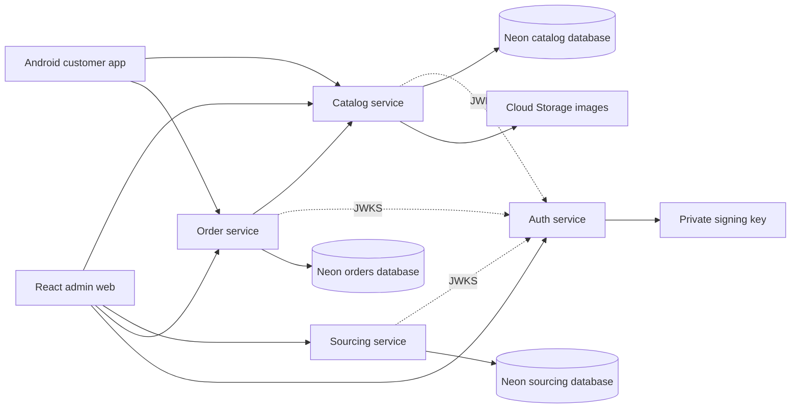

# Architecture

## Business model

One platform product can map to many vendors. The customer-facing product has a platform SKU, description, images, unit, and published price. Each vendor offer has its own vendor SKU, cost, availability, lead time, and active state. The customer API never returns vendor names, costs, or mappings.

## Data ownership

- **Catalog service:** `products` and published retail data. Public reads and admin writes.
- **Sourcing service:** `vendors` and `vendor_offers`. Admin-only reads and writes. A unique `(product_id, vendor_id)` pair prevents duplicate mappings.
- **Order service:** customer order, immutable retail price snapshot, delivery address, status, and cash-on-delivery payment method. It owns its database and uses an idempotency key for checkout.
- **Auth service:** checks admin credentials and signs 15-minute JWTs with an RSA private key. The other services verify the signature, issuer, audience, expiry, and `admin` scope using the public JWKS. They do not keep server-side login sessions or hold the private key.

The admin UI loads products from the catalog service, then creates offers in the sourcing service using product IDs. Once order workflows exist, use an outbox event from the catalog service for product changes and a reconciliation job for stale product references. Avoid shared tables or cross-service joins.

The current HTTP `DELETE` endpoints deactivate products and vendors, preserving their IDs for existing mappings. Vendor offers can be deleted independently.

## Checkout flow

1. Android shows active products and lets a customer add them to the cart.
2. The app sends product IDs, quantities, customer delivery details, the displayed total, and a UUID idempotency key to `POST /api/orders`.
3. The order service fetches current products from the catalog service, recalculates each line and the total, and rejects unavailable products or a changed price.
4. It saves one order and immutable item snapshots in a transaction. A retry with the same idempotency key returns the same order.
5. Admin reviews the order and advances `PLACED → CONFIRMED → PACKING → OUT_FOR_DELIVERY → DELIVERED`, or cancels before delivery.

The MVP uses cash on delivery and a zero delivery fee. Stock is checked manually before confirmation; no vendor allocation or inventory reservation is implemented yet. The customer API has no public order lookup because customers do not yet have accounts.

## GCP deployment path

1. Containerize each Spring Boot service and deploy to Cloud Run in a region near users and the selected Neon region.
2. Create separate catalog, sourcing, and orders PostgreSQL databases and roles in Neon. Give each service credentials only for its database. Use Neon's pooled endpoints for application traffic, small Hikari pools, and Cloud Run maximum-instance caps. Use direct connections for schema migration jobs if pooled connections cause migration or session-state issues.
3. Store product images in Cloud Storage and serve them through a CDN. Mount the auth signing key and admin password from Secret Manager; give each Cloud Run service a distinct service account.
4. Host the React static build on Firebase Hosting or Cloud Storage with HTTPS. The Android app calls the public catalog and order APIs over HTTPS.
5. Before production, set stable signing keys and an HTTPS issuer, put staff identity lifecycle and login abuse protection in place, and use a controlled public API entry point. Add an admin backend or gateway before making the sourcing Cloud Run service private with service-to-service IAM; the current React app calls it directly. Add Cloud Logging, Monitoring, alerts, and verify Neon backup and recovery settings.
6. Add Cloud Tasks for single-recipient background work such as allocation or notifications; use Pub/Sub only when multiple independent consumers need the same business event.

All four Spring projects include Dockerfiles. Set `PORT` to the Cloud Run listening port. The catalog, sourcing, and order services need `SPRING_PROFILES_ACTIVE=postgres`, and their own Neon JDBC `DB_URL`, `DB_USER`, and `DB_PASSWORD`; the order service also needs `CATALOG_API_URL`. Keep credentials in Secret Manager. Auth-service needs a persistent RSA key pair via `JWT_PRIVATE_KEY_PATH` and `JWT_PUBLIC_KEY_PATH`, plus `ADMIN_PASSWORD` or `ADMIN_PASSWORD_HASH`. All services need the same `JWT_ISSUER`; the three resource services need `AUTH_JWKS_URI`. Staff identity lifecycle, API rate limits, and private service routing are required before a production deployment with real customer and vendor data.

## Decisions needed before production checkout

- Who is the merchant of record, who invoices, and who handles returns?
- Does an order pick one vendor automatically or require admin selection?
- Is published price global or dependent on city, quantity, and customer account?
- Is availability entered by admins or synchronized from vendor systems?
- Which payment provider will handle prepaid orders, if offered?

## Current implementation limits

The admin UI supplies product IDs from the catalog, but the sourcing API does not yet validate those IDs; there is no relational foreign key across databases. Checkout does not reserve stock or assign a vendor. JWT auth currently covers staff only; anonymous customer checkout remains public. A production deployment needs staff account lifecycle, customer identity or a secure order lookup policy, abuse protection on public checkout, and a private sourcing endpoint before real transactions are accepted.
